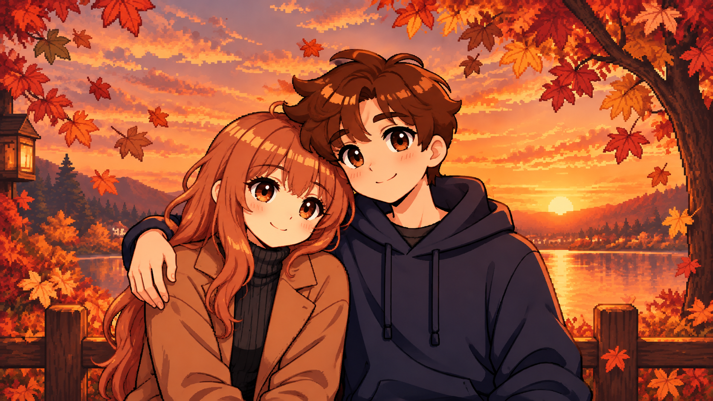

# 🍁 💗 Para Gabi, minha flor de tangerina

*Algumas coisas são difíceis de explicar, mas sempre encontram um jeito de florescer em palavras.*

🍂 ━━━━━━━━━━━━━━━━━━━━━━━━━━━━━ 🍂

Este pequeno projeto nasceu de um sentimento que já não cabia apenas dentro de mim.

Desde 16 de agosto, quando nossos caminhos se cruzaram, muita coisa mudou. E, desde 26 de setembro, tenho a alegria de chamar você de minha namorada.

Entre conversas, chamadas, risadas, timidez, nervosismo e tantos pequenos momentos, construímos algo nosso. Não se trata de deixar de ser quem somos para nos tornarmos um só, mas de aprender a coexistir, respeitando nossas individualidades e escolhendo caminhar lado a lado.

Este projeto é uma pequena tentativa de reunir aquilo que às vezes minha voz não consegue expressar tão bem: meus sentimentos, minhas lembranças, meus poemas e todas as palavras que nasceram porque você existe.

🍁 ━━━━━━━━━━━━━━━━━━━━━━━━━━━━━ 🍁

## 🌷 Para minha musa inspiradora

Gabi, você me inspira a escrever, a imaginar e a transformar sentimentos em palavras. É presença, carinho e luz nos meus dias.

Talvez eu nunca consiga colocar em um único texto tudo aquilo que sinto, mas espero que cada pedacinho deste projeto consiga transmitir um pouco do quanto você é especial para mim.

🍂 ━━━━━━━━━━━━━━━━━━━━━━━━━━━━━ 🍂

## 💌 Uma pequena dedicatória

<!-- COLE AQUI os versos da dedicatória, no formato:
> primeiro verso  
> segundo verso  
-->

**Com amor,**

*Edu — seu marinheiro azul 💙*

🍁

---

Feito com carinho, algumas palavras, muita inspiração e um coração que encontrou em você sua flor de tangerina. 🍊

